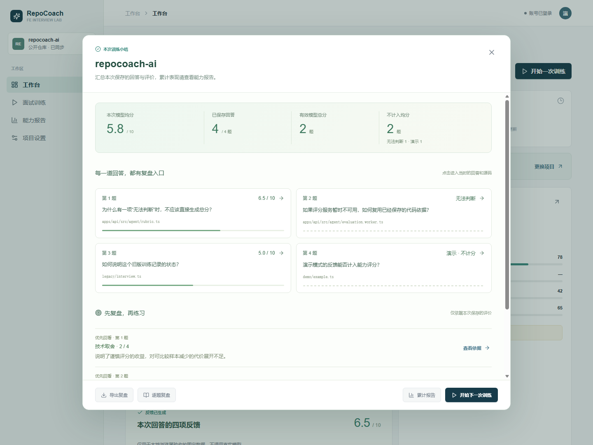
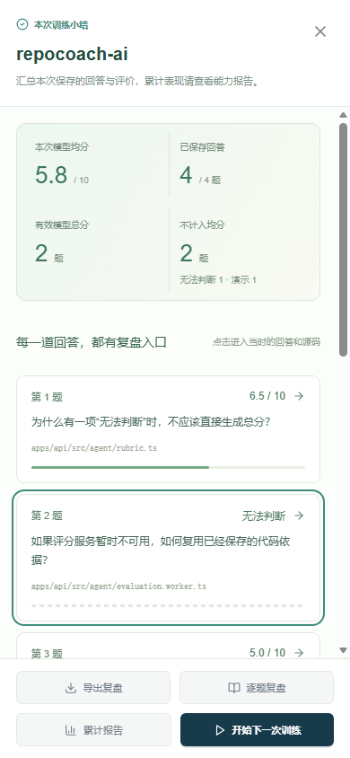
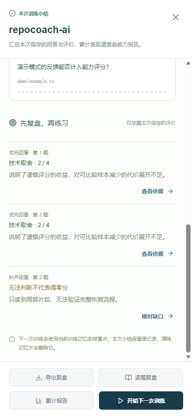

# 本次训练小结

2026-10-28 追加升级：在训练结束和累计能力报告之间增加本次小结，回答“这次练得怎样、先回看哪一题、下一步做什么”。沿用浅色青绿风格，部署与验证状态见[本轮发布记录](releases/2026-10-28.md)。

## 使用路径

真实训练最后一题完成后，点击「查看本次小结」。在能力报告的最近训练曲线中选中某一次训练，也可以点击「本次小结」重新查看，因此刷新后仍有入口。进行中训练的小结会说明只包含已保存回答；本地示例训练不请求服务端详情。

小结展示当次模型均分、已保存回答、有效模型总分和不计入均分的数量。逐题卡片显示题目、文件和结果，点击打开该题复盘；再从复盘核对源码、行号与评分理由。嵌套弹窗每次 Esc 只关闭一层，返回保留入口焦点。

「先复盘，再练习」最多选出两道有保存引用的低分分项，每题只选一项，按分项分数升序排列。无法判断的题目另设「补齐依据」入口，不将证据缺口当作零分或已确定的能力短板。没有可引用的低分建议时明确显示说明，不编造练习结论。

底部支持完整 Markdown 导出、逐题复盘、累计报告与下一次训练。下一次训练仍由服务端依据当前训练记忆安排，打开小结不会调用评分或启动训练；清除训练记忆也不删除已保存的小结来源。若已有未完成训练，仍先确认是否开始新训练；启动失败继续保留原题、回答和反馈。

## 数据口径与恢复

- 小结从现有会话详情读取，按已保存回答重算统计；不使用累计报告或最近训练列表的汇总值代替本次结果。
- 只把 `deepseek` 的有限、0–10 范围内总分纳入均分，真实零分有效；演示、null 或非法数值不计入。没有有效总分显示破折号。
- 练习建议需要 0–4 范围内且不高于 2 的模型分项、非空理由，以及能对应到同题保存片段的引用。它是复盘优先级，不代表效果保证。
- 加载失败有重试入口，尚未加载成功时禁用复盘和导出。关闭小结后迟到的请求不能更新新打开的小结。
- 返回的会话 ID 与项目 ID 必须同时匹配；工作区按账号隔离，切换项目隐藏旧小结。
- 手机使用全屏弹窗，内容在中间滚动，底部操作保持可见；没有新增依赖、数据库迁移或额外模型请求。

实现入口：`apps/web/app/components/session-summary.tsx`、`apps/web/lib/session-summary.ts`。统计规则有单元测试，生产界面浏览器验收增加第六组，覆盖读取失败与重试、混合评分、逐题定位与焦点、三级弹窗、导出、手机布局、项目不一致、迟到响应、空记录、演示、启动失败、未完成训练确认与草稿保护，以及下一次训练。完整验收范围见[本地验收记录](demo-readiness.md)。

## 本地验收截图

以下采用生产前端与固定 API 数据，不代表真实用户的成绩或学习效果。

