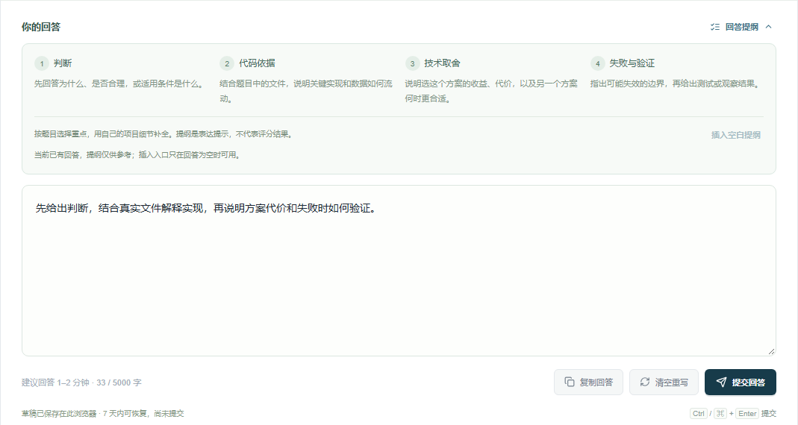
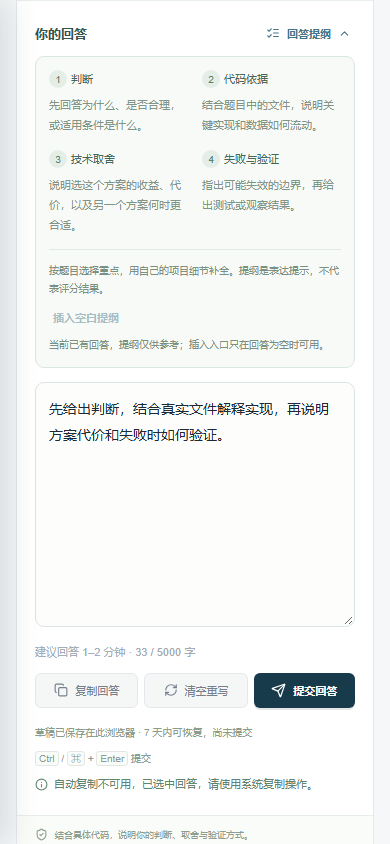
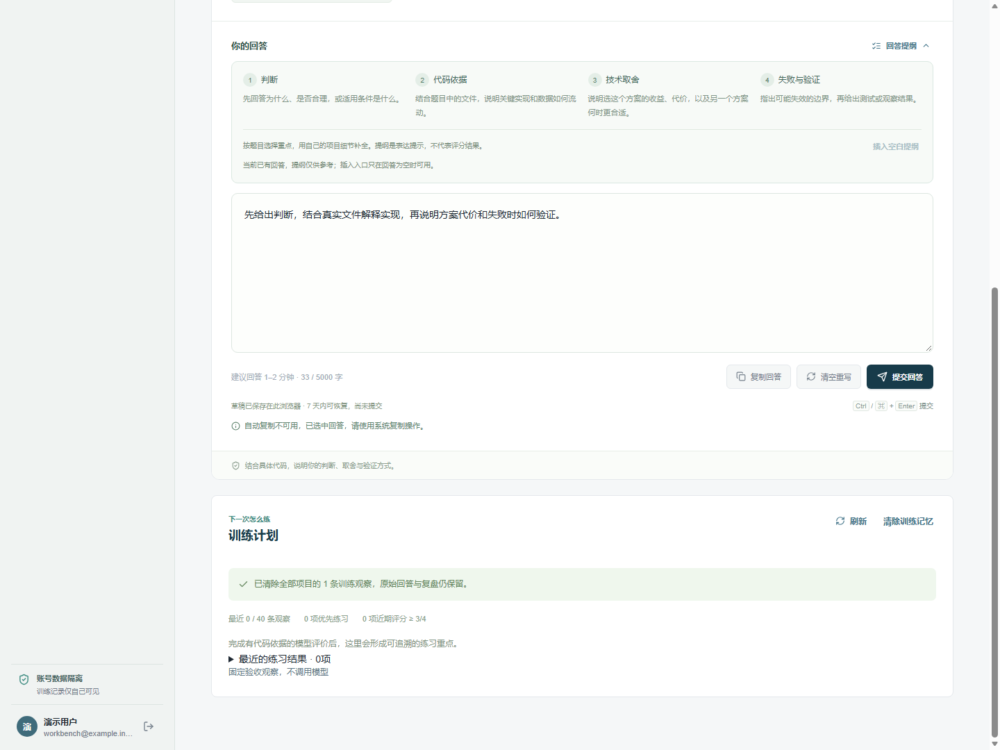

# 回答与训练计划体验

2026-10-28 追加升级。沿用浅色青绿工作台、现有评分接口和训练记忆接口，不增加模型请求、运行时依赖或数据库迁移；部署与验证状态见[本轮发布记录](releases/2026-10-28.md)。

## 回答组织

回答区右上角可展开“回答提纲”：判断、代码依据、技术取舍、失败与验证。提示帮助组织自己的表达，不自动生成答案，也不推断回答质量或预估评分。

回答为空时可以插入四段空白提纲；有内容时该入口禁用，阅读提示不会改写已有回答。插入后的内容沿用原草稿规则，刷新可以恢复。

| 操作                         | 行为                                                                     |
| ---------------------------- | ------------------------------------------------------------------------ |
| `Ctrl + Enter` / `⌘ + Enter` | 与点击提交回答相同，空回答或提交中不会提交；普通 Enter 仍用于换行        |
| 中文输入法确认文字           | `isComposing` 或兼容的 229 键码不触发快捷提交；按键重复不触发            |
| 复制回答                     | 用户点击后复制当前文本，明确提示结果；权限受限时选中文本供系统复制       |
| 清空重写                     | 先确认；默认焦点在“保留回答”，Esc 返回原入口；确认后同时移除对应本机草稿 |
| 提交失败                     | 输入与草稿保留，快捷提交也沿用相同失败恢复逻辑                           |

提纲和复制结果属于本题 UI 状态，切换题目后重置。手机采用两列提纲、自动换行的操作区，保留完整回答宽度。

## 训练计划反馈

训练页增加明确的读取中、读取失败、重新加载和主动刷新入口。尚在读取或读取失败时不显示“没有练习重点”，避免把故障当成无数据。

概览显示最近观察数量、最多 40 条窗口、当前优先练习数量，以及最新分项评分达到 3/4 的数量。统计表示有据模型观察，不作为长期能力认证，也不把最新较好评分一律解释为学习进步。每条重点仍可直达来源训练的具体题目与源码依据。

清除前确认范围是全部项目的训练观察；完成后展示服务端实际清除数量，并说明原始回答与复盘保留。清除失败保留重试入口，同时重新读取计划以核对服务端结果；网络失败不声称服务端一定没有执行。

训练页和能力报告共用 `useTrainingMemory`。它校验结果的项目 ID，用操作代次与组件生命周期屏蔽过期请求；清除开始时立即使此前 GET 失效，结束后重新读取，防止旧响应重新显示已清除的观察。同步操作锁阻止连续点击重复清除。

清除中切换到能力报告时，即使原计划组件已经卸载，清除完成仍通知当前账号工作区刷新报告；账号已退出时忽略这条旧通知。

## 验证

前端单元回归、lint、TypeScript 与生产构建通过。`npm run test:browser` 在原训练、复盘、报告和会话恢复检查之外增加体验组，使用生产前端与隔离固定 API，不产生真实模型请求。

体验组覆盖：插入提纲与已有回答保护、清空确认和焦点、清除草稿后的刷新、复制成功/拒绝降级、中文输入与普通 Enter、两种快捷键、失败保留回答、390px 手机布局、计划加载/失败/重试、项目不一致拒绝、来源题定位、清除失败、重复清除保护、旧读取不复活记忆、清除计数、保留当前回答，以及清除中切换页面后的报告同步。

实现入口为 `apps/web/app/components/answer-composer.tsx`、`training-memory.tsx` 和 `apps/web/lib/use-training-memory.ts`，验收入口为 `apps/web/test/browser/acceptance.cjs`。此前完整数据库、HTTP 与 Agent 验收范围见[求职演示版本地验收](demo-readiness.md)。

## 界面截图

以下来自生产前端与隔离固定 API 数据，展示交互，不代表真实用户评分效果。

