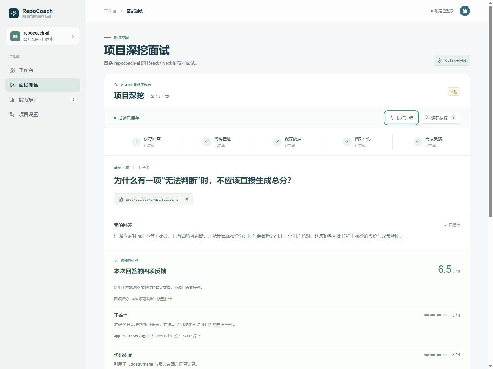
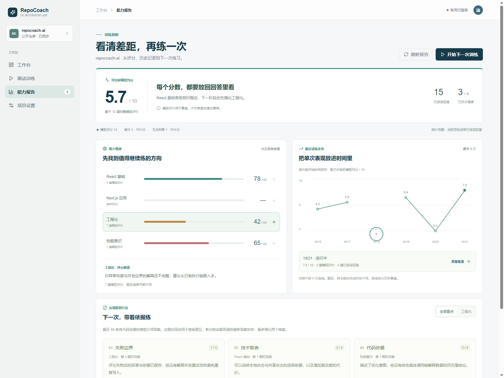
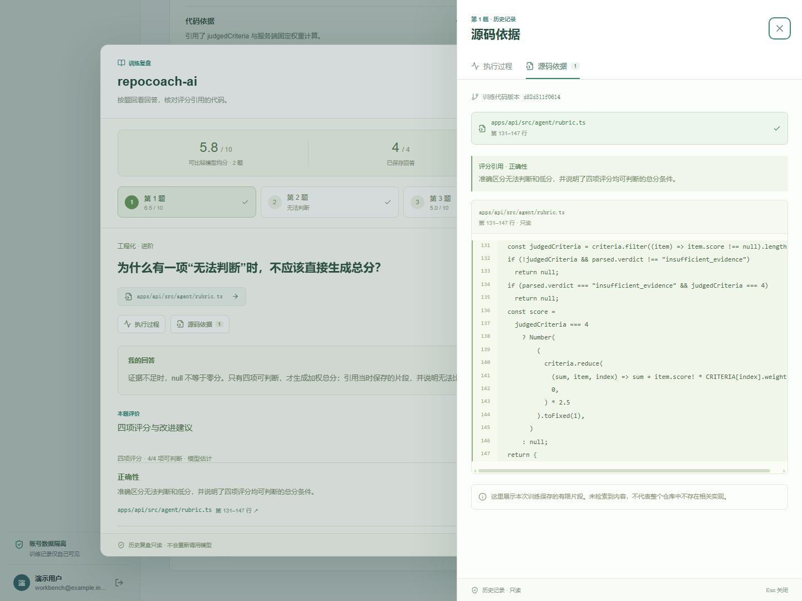

# 可视化训练工作台

本轮选择：保留浅色青绿界面，扩大回答区；执行过程与源码通过右侧抽屉按需查看。部署与线上验证状态见[2026-10-28 发布记录](releases/2026-10-28.md)，本页描述交互与数据边界。

## 使用方式

- 主区域呈现题目、可编辑回答、已保存回答与四项反馈。桌面不常驻三栏，手机不挤压答题区域。
- 顶部阶段条展示保存回答、代码查证、保存依据、四项评分、完成反馈。点击阶段或“执行过程”查看已保存事件、工具状态和耗时。
- 点击问题文件或评分引用打开源码抽屉，显示引用理由、文件、行号和训练保存的片段。可在多个引用间切换。
- 评分阶段失败时，已完成的回答保存与代码依据阶段继续显示完成；重试仅调用既有阶段重试接口，不重新提交回答。
- 抽屉支持 Tab / Shift+Tab 循环、Esc、遮罩和关闭按钮；关闭返回原入口。切换题目或会话会重置抽屉选择。

## 历史训练复盘

从最近训练或训练记忆进入“训练复盘”，先看模型均分、已保存回答数与题目导航，再集中阅读一道题的原始回答和四项反馈。题目导航区分正常评分、无法判断、演示反馈和未回答；未回答的题目不能打开。上一题、下一题在已保存回答之间切换。

复盘复用训练页的执行与源码抽屉。点击评分引用可查看对应的理由、文件行号、片段和当时保存的版本；切换题目会清空上一题的引用选择。阶段事件只在打开执行过程时读取，不因打开复盘就请求所有题目的事件。导出 Markdown 仍包含本次训练的所有回答，不局限于当前选中的题。

加载详情失败时保留弹窗并提供重新加载；关闭后返回的旧请求不更新新打开的记录。旧记录缺少四项评分、源码或阶段事件时分别显示缺失提示。没有保存回答的训练显示空态。null 与演示评价不计入可比较模型均分，演示原始数值不在逐题评分中展示。

复盘与源码抽屉使用原生对话框，每次 Esc 只关闭最上层。关闭抽屉后保留复盘的题目、滚动位置和入口焦点；只有所有对话框关闭后才恢复页面滚动。手机采用全屏复盘，题目导航在自身区域内横向滚动，代码在片段内部滚动。

## 交互式能力报告

能力报告以“看清差距，再练一次”为入口，保留浅色青绿风格，连接评分、历史复盘和下一次训练：

- 总览显示当前项目的可比较模型均分、已保存回答、已评分维度及模型、演示、无法判断的样本数。没有可比较评分时显示破折号；不将模型评分描述为面试通过概率。
- 维度条可以点击，显示对应反馈与样本数。默认选中最低的已评分维度；尚未评分的维度不按零分排序。只有一道回答时明确提示继续验证。
- 最近训练曲线展示接口提供的最多六次会话，按开始时间排列。每个点显示当次模型均分，支持鼠标和键盘选择，再进入该次复盘。没有可比较评分的会话保留空缺并中断连线；真实的零分仍显示为零。进行中与已完成的状态、样本数在选中后展示。
- 练习卡片来自训练记忆接口的有代码依据的模型分项观察，展示建议、文件、版本和来源题号。按所选维度筛选不会改变训练计划；“开始下一次训练”仍由服务端根据最新观察安排，最多强化两个维度。点击建议直接打开来源题目，继续使用共用源码侧栏。
- 统计报告覆盖当前项目全部保存回答；曲线仅覆盖最近六次会话；训练观察窗口为最近四十条。这些范围分别标明，不把曲线变化归因为能力提升。

报告加载失败与没有数据分别展示。刷新失败时保留上次成功读取的报告，并提示重新加载；训练记忆可以单独重试。请求按账号和项目隔离，切换项目时立即隐藏旧报告，已失效的迟到响应不覆盖新报告。工作台概览同步将未评分显示改为破折号。

实现使用现有报告、训练记忆、会话详情和开始训练接口，未增加依赖、数据库结构或额外模型调用。

## 本次训练小结

最后一题完成后先进入[本次训练小结](session-summary.md)，按当次保存回答展示均分和逐题结果，演示与无法判断独立计数。低分建议需要保存的源码引用，证据缺口另行提示；可进入对应题复盘、导出、累计报告和下一次训练。能力报告选中一次训练后也能重开，进行中记录明确标注未完成。

## 草稿与会话恢复

追加的[回答与训练计划体验](training-experience.md)提供可展开的四段提纲、Ctrl/⌘ + Enter 提交、复制降级和清空确认；训练计划补齐读取、重试与清除计数，清除后旧请求不能写回观察。

未提交回答自动保存在当前浏览器，按账号、项目、训练和题目隔离，7 天有效，最多保留 20 份。输入区限制 5000 字，明确区分“本机草稿尚未提交”和服务端已保存回答。提交被服务端确认后删除对应草稿；退出登录清除该账号的本机草稿。存储不可用时保留当前输入并提示离开前复制，不阻断训练。

刷新先读取当前项目训练进度，失败时显示重试入口并暂停新训练，避免误创建会话。恢复时优先使用服务端不可改写的回答与任务状态；已有完成反馈立即展示。仅恢复最新一场训练，最新训练已完成时不会复活更早遗留的未完成训练，旧记录仍可复盘。

开始新训练前确认是否继续当前训练；启动失败保留原题与草稿，快速重复点击不会创建多场训练。提交失败保留输入；运行中的取证/评分任务阻止新训练入口。切换项目或账号会隐藏旧训练并使其尚未返回的请求失效，迟到的启动、提交、报告与事件不会覆盖新工作区。SSE 不可用时使用既有轮询恢复机制。

登录检查的网络/服务故障显示“重新连接”，不会误判成退出登录；只有明确 401 才进入登录页。仓库导入错误显示在当前弹窗内，关闭弹窗后返回的旧分析不会替换项目。浏览器中损坏的项目缓存会被忽略，存储受限有明确提示。

## 数据与展示边界

阶段条以服务端持久化 `EvaluationRun.phase/status` 为准，不根据定时动画或收到多少条 SSE 推断进度。新建和恢复的任务均适用；旧版或本地演示没有事件时明确显示无记录。

事件抽屉按需分页加载历史事件，与 SSE 事件按序号合并去重。失败可以重新加载，训练与历史复盘共用同一查看入口。完成后的工具汇总来自评价内的 `EvidenceTrace`，查证耗时与取证模型调用数不冒充整个任务的耗时或总调用数。

源码只来自已保存的题目片段和评价 `evidence.items`。版本号只取评价依据或查证记录中的 commit；题目接口未提供版本号时明确说明，不使用本地缓存项目的 commit 代替。工具记录只有文件路径时，定位该文件的已保存片段供核对；不承诺重现工具原始输出。没有保存引用片段的调用显示明确空态。

评分项为 null 时保持“无法判断”，不转换为零分；本地演示不展示可比较总分。引用缺失时显示提示。检索空命中与超出已加载范围分别呈现，避免让用户理解成整个项目没有相关实现。此轮没有新增模型请求、数据库迁移或模型质量指标。

## 验证

`npm run test:web` 共 19 项：5 项请求边界、4 项草稿与项目缓存、4 项工作台阶段、3 项报告数据及 3 项本次小结统计测试。覆盖未评分与真实零分的区分、会话按时间排列且不改写接口数据、缺失样本处中断曲线、小结混合评分及练习建议引用边界。

前端 lint、TypeScript 与生产构建通过。使用生产前端连接隔离的本地固定 API 数据进行 Edge 浏览器验收：

- 训练：草稿保留、侧栏焦点循环与 Esc 返回、分页事件、评分失败重试、SSE 完成、源码引用和 commit、缺失片段、下一题重置、刷新恢复、null 分数。
- 复盘：失败重新加载、逐题切换、事件按需读取、嵌套弹层与焦点恢复、返回原滚动位置、不同题目同名引用 ID 的隔离、旧记录空态、演示与 null 评分、全部回答的 Markdown 导出、慢请求不覆盖新记录、无回答空态。
- 报告：选择维度、未评分不冒充零分、真实零分与断线、键盘选择曲线点、曲线进入会话复盘、建议直达具体题目及源码、刷新保留旧数据并提示、首次加载失败、记忆单独重试、仅演示评分项目、开始训练接回服务端重点、切换项目忽略迟到响应。
- 恢复：草稿跨刷新、读取进度失败重试、重开训练确认与失败保留、重复点击保护、存储不可用、提交失败、服务端回答优先、完成反馈恢复、无 SSE 轮询、处理中禁止新训练、启动/提交迟到响应隔离、导入弹窗错误、401 与服务故障区分、退出清草稿与账号隔离。
- 布局：1440/1600px 桌面与 390px 手机截图检查；报告、复盘和源码侧栏均无页面横向溢出，浏览器无未捕获异常。

浏览器验收已纳入仓库：`apps/web/test/browser/acceptance.cjs`，执行 `npm run build` 后运行 `npm run test:browser`，需要已安装 Chrome/Edge。结果写入被 Git 忽略的 `data/browser-acceptance-<uuid>/`。CI 在生产构建后执行同一套浏览器检查，失败时保存截图与检查结果；本轮尚未推送触发远端 CI。

此项验证交互与接口契约，不代表再次调用真实 DeepSeek 或完成线上验收。完整范围、数据库检查与限制见[求职演示版本地验收](demo-readiness.md)。

## 新版截图

以下为生产前端与隔离固定数据的浏览器验收截图，展示界面与交互，分数不代表真实用户效果：

